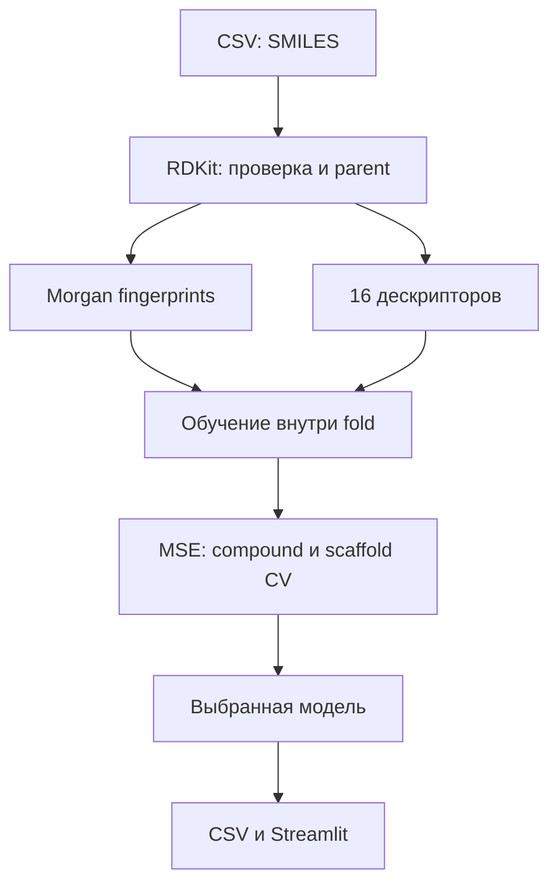

# План завершения проекта

## Архитектура и принятые решения

На 320 размеченных строках выбран CPU baseline с Morgan fingerprints radius=2 (2048 bits),
16 физико-химическими дескрипторами и простыми регрессорами. Это позволяет быстро сравнить модели,
проверить утечки и сохранить время на качество данных. GNN и большие предобученные модели пока не обоснованы.

Признаки считаются для FragmentParent после нейтрализации. Стереохимия сохраняется в признаках,
но удаляется из ключа группы для CV. Таутомеры специально не объединяются; это отдельный будущий эксперимент.
Murcko scaffold определяется на той же родительской структуре. Сохраняются исходные строки и связи с ними.
Дубликаты не усредняются до CV: измерения одной группы попадают в один fold.

## P0: сдаваемое и воспроизводимое решение

| Задача | Критерий готовности | Статус пакета |
|---|---|---|
| Контракт данных | реальные имена колонок, запрет утечки, MSE | выполнено |
| EDA | пропуски, метки, дубликаты, сходство | выполнено |
| Baseline | сохранённая модель и честная CV | выполнено |
| Submission | все index по шаблону, конечные значения | выполнено локально |
| Воспроизведение | обучение с нуля → тот же CSV | выполнено; сводка в reports/verification_summary.json |
| Открытые данные | реальные измерения, provenance и валидация | 6148 измерений ChEMBL, кэш и manifest |
| Научная курация | пары одного контекста, проверенные SI | проверены 5 пар из одной статьи; все пересекаются с train/test; остальные требуют проверки |
| GitHub | запускаемый репозиторий без секретов | код опубликован; изменения проверяются перед обновлением |
| Kaggle | CSV принят и реальный score записан | требуется отправка командой |

Расширение данных — часть обязательного требования, поэтому курация имеет приоритет P0.
Если использовать только исходный train, честно показывать этот факт. Нельзя называть 6148 измерений
6148 размеченными молекулами для SI или утверждать, что все они использованы в модели.

## P1: последовательность измеримых улучшений

1. Получить от организаторов определение SI=10000 и нулевых значений. До ответа не править метки.
2. Разобрать `data/external/pair_review_queue.csv`: начать с both_exact + same_known_cell_type,
   но также сверить длительность, источник, штамм, контекст антивирусного assay и контрольную культуру.
   Зафиксировать reviewer, DOI и таблицу/страницу. Не заполнять неопределённость предположениями.
3. Сделать отдельный `external_curated.csv` с одним проверенным assay context в строке;
   формат `smiles,IC50,CC50,SI,doi,unit,relation,cell,strain,exposure,source_url,reviewer,evidence`.
   Для точного SI нужны точные положительные сопоставимые концентрации. Нижние/верхние границы сохранять отдельно.
4. Прежде чем расширять train, проверить совпадения с исходными train/test, публикации и серии.
   Не заменять метки test найденными внешними данными. Получить разъяснение правил, если внешний источник
   пересекается с приватным test. Для CV external фильтруется заново в каждом fold по compound/scaffold.
5. Сравнить baseline и baseline+external на прежних folds/seeds с raw MSE; показать количество
   добавленных уникальных структур, ошибку по похожим/непохожим молекулам и отрицательный transfer при его наличии.
6. Ограниченный следующий модельный эксперимент: усреднение RF + Tanimoto Kernel Ridge с заранее заданными
   весами 0.5/0.5; затем небольшая сетка RF min_samples_leaf и max_features. Всё оценивается по тем же folds.
   Результат после выбора по CV не считать независимой финальной оценкой.
7. Если нужна численная неопределённость, выделить отдельную групповую calibration выборку для conformal
   регрессионных интервалов; показать эмпирическое покрытие и ограничение переносимости на новые scaffolds.
   Не превращать Tanimoto или разброс деревьев в обещание 95% уверенности.

## P2: только после закрытия P0/P1

Таутомерная нормализация, count fingerprints, предобученные molecular embeddings, небольшой GNN или multi-task
CC50/IC50 допустимы только как отдельные обоснованные эксперименты с реальными метками и разрешением правил.
Запрет входных концентраций не означает разрешения подменить основную задачу вычислением отношения на test.

## Разделение работы четырёх участников

| Участник | Ответственность | Результат для команды |
|---|---|---|
| A: ML lead | baseline, splits, raw MSE, интеграция | проверенная модель и журнал экспериментов |
| B: data/research | ChEMBL, публикации, курация и DOI | проверенные дополнительные SI и отчёт о происхождении |
| C: Python/demo | CLI, тесты, Streamlit, воспроизведение | рабочее демо и запускаемый репозиторий |
| D: validation/pitch | ошибки, ограничения, Kaggle, защита | подтверждённый score, слайды и сценарий |

## Рабочие контрольные точки по Москве

- 6 ноября, 19:00–22:00: P0 baseline, EDA, первая корректная отправка на Kaggle.
- Ночь и утро 7 ноября: курация внешних источников и ограниченные эксперименты.
- 7 ноября, до 16:00: выбрать финальную модель по заранее определённой локальной валидации;
  не подстраивать десятки вариантов под public leaderboard.
- 7 ноября, 16:00–19:00: чистое воспроизведение, упаковка данных/кода, демо и материалы защиты.
- 7 ноября, 19:00: заморозить код; до 20:00 проверить доступность GitHub и окончательную отправку.
- 7 ноября, 21:00: официальный дедлайн сдачи.
- 8 ноября, до 11:00: прогон защиты; отдельная демонстрация без зависимости от внешних API.

Если команда начинает позже, сокращать число экспериментов, сохраняя время на воспроизводимость и сдачу.

## Что спросить у экспертов

Главный вопрос: «Почему в train SI=10000 ровно у строк с отсутствующим IC50: это измерение,
нижняя граница, заглушка или преобразование пропуска, и как интерпретировать две нулевые метки?»
Также зафиксировать условия использования внешних данных, лимит submission и требования к размещению
данных приватного соревнования в GitHub. В пакете не предполагается ответа на эти вопросы.
